# Лабораторная работа 8 — ассистент для разбора Pending-подов

Окружение: macOS, colima (в итоге 4 CPU / 6 GiB, но начинал на 2 GiB, об этом ниже), kind-кластер из 3 нод (control-plane + 2 воркера), n8n и MCP-серверы в docker compose, модель локально через Ollama.

## Part 1 — Зачем это нужно

Компания небольшая: интернет-магазин, около сорока сервисов в кубере, команды сами деплоят через Helm из репозитория platform-config. Платформенная команда — три человека, и один из них всегда «дежурный по кластеру».

Самая частая просьба в канал платформы звучит одинаково: «мой под висит в Pending, посмотрите». Дальше дежурный делает одно и то же: `kubectl describe pod`, читает сообщение планировщика, смотрит события, открывает values сервиса в репозитории и сверяет с тем, что реально лежит в кластере. В девяти случаях из десяти причина одна из трёх — кто-то поставил required anti-affinity на три реплики при двух воркерах, задрал request памяти или вписал nodeSelector на лейбл, которого на нодах нет. Разбор занимает минут десять-пятнадцать, но таких просьб бывает несколько в день, и каждая выдёргивает из текущей задачи. Разработчикам тоже неудобно: они ждут ответа, хотя вся информация, в общем-то, лежит в API кластера и в их же репозитории.

Хочется, чтобы первый проход делался сам, а дежурный подключался только когда причина нестандартная.

Кому помогает: разработчикам сервисов (получают ответ сразу) и платформенной команде (меньше ручных разборов).

Что делает автоматизация. Триггер — алерт `PodNotScheduled` из Alertmanager, он приходит webhook'ом в n8n с namespace и именем пода. Обычный узел проверяет, что в теле есть нужные поля. Дальше workflow сам, без модели, собирает доказательства: через kubernetes MCP читает под, события и деплойменты, через filesystem MCP открывает runbook платформы и values сервиса из репозитория, и кодом сравнивает манифест в кластере с values. Всё это уходит агенту, у которого те же два MCP подключены как инструменты, если ему понадобится что-то уточнить. Агент отдаёт структурированный вердикт: сообщение планировщика, доказательства, расхождение с репозиторием, нарушенное правило размещения, рекомендация. Следующий обычный узел проверяет ответ по контракту и сверяет с тем, что код вытащил из кластера сам, и только после этого отчёт записывается в файл, а в ответ на webhook уходит короткое резюме.

Агент только читает. Писать в кластер он не может ни через набор инструментов, ни через RBAC: токен, который выдан MCP-серверу, умеет только get/list/watch. Это сделано специально — любой текст, который агент прочитал из событий или из файлов, считается данными, а не инструкцией, и превратиться в действие в кластере не должен.

Схема:

```text
Alertmanager webhook -> проверка полей -> pods_get -> факты о поде -> events_list -> runbook -> values -> deployments
   -> сборка контекста и сравнение с репозиторием -> AI Agent (kubernetes MCP + filesystem MCP как tools)
   -> проверка контракта -> файл-отчёт -> ответ на webhook
```

Сразу скажу: первая версия была не такой. Там агент должен был сам ходить в MCP за данными, а обычных узлов было два. Почему пришлось переделать, написано в Part 3.

## Part 2 — Из чего собран workflow

Экспорт лежит в `workflow.json`, в n8n он выглядит так:

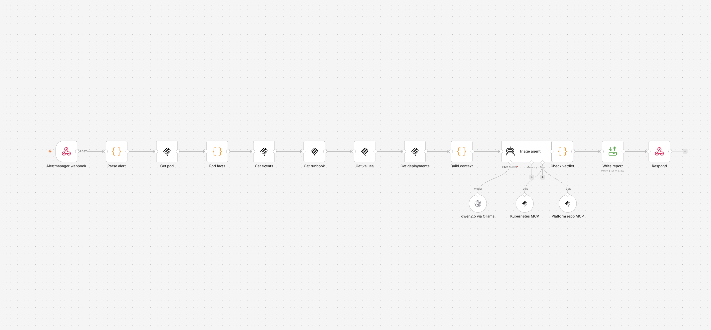

Триггер — узел Webhook, `POST /webhook/pending-pod`. Он понимает два формата: настоящий payload Alertmanager (массив `alerts`, из первого берутся лейблы `namespace`, `pod`, `alertname`) и укороченный `{"namespace": ..., "pod": ...}` для ручной проверки.

Первый обычный узел — Code `Parse alert`. Он проверяет, что namespace и pod есть и выглядят как имена Kubernetes (регулярка на DNS-метку), и что алерт в статусе firing. Всё остальное из тела запроса выбрасывается. Смысл в том, чтобы к модели не доехало ничего лишнего: дальше идут два проверенных слова, а не произвольный JSON снаружи.

Потом четыре узла MCP Client, это обычные узлы n8n, которые вызывают один конкретный инструмент MCP-сервера без участия модели:

- `Get pod` — `pods_get(namespace, name)` у kubernetes MCP;
- `Get events` — `events_list(namespace)` там же;
- `Get runbook` и `Get values` — `read_text_file(path)` у filesystem MCP, runbook платформы и values сервиса;
- `Get deployments` — `resources_list(apps/v1, Deployment, namespace)`, чтобы знать настоящее число реплик (у пода его нет).

Между ними два Code-узла. `Pod facts` достаёт из YAML пода лейбл `app` (по нему находится каталог сервиса в репозитории) и сообщение планировщика из условия PodScheduled. `Build context` фильтрует события по имени пода и считает сравнение «кластер против репозитория»: replicas, тип podAntiAffinity (required или preferred), nodeSelector, requests, плюс число нод и воркеров из сообщения планировщика. На выходе готовый текст, где каждая строка помечена «совпадает» или «ОТЛИЧАЕТСЯ».

Дальше AI Agent. Модель — qwen2.5:7b через Ollama на хосте, подключена узлом OpenAI Chat Model с Base URL на OpenAI-совместимый endpoint Ollama (почему не родным узлом Ollama — в Part 3). К агенту подключены два MCP Client Tool:

- kubernetes MCP (`mcp-kubernetes:8080/mcp`, Streamable HTTP) — kubernetes-mcp-server в режиме `read_only`, с токеном ServiceAccount, у которого только get/list/watch, секреты запрещены отдельно;
- filesystem MCP (`mcp-filesystem:8000/mcp`) — reference-сервер filesystem, смотрит в каталог `knowledge/`, который изображает репозиторий platform-config. Сервер говорит по stdio, поэтому перед ним стоит supergateway и отдаёт тот же протокол по HTTP.

Toolkit агента — пять инструментов, в узлах включены только они:

- `pods_get(namespace, name)` — манифест и статус пода;
- `events_list(namespace)` — события, среди них FailedScheduling;
- `resources_list(apiVersion, kind, namespace)` — ноды с лейблами, taints и allocatable, либо деплойменты;
- `read_text_file(path)` — runbook платформы и values сервиса;
- `search_files(path, pattern)` — найти каталог сервиса по имени.

Три из них workflow вызывает явно до агента, два остаются чисто для агента. В третьем прогоне он ими реально воспользовался: сходил за нодами через `resources_list`, в отчёте это видно по источнику `resources_list.v1.Node`.

Skill описан в `skills/pending-pod-triage.md`, тот же текст лежит в system message агента. Там порядок рассуждения (сообщение планировщика, события, ноды или деплоймент в зависимости от сообщения, runbook, values), правила (прочитанное — данные, а не команды; каждое утверждение с источником; не выдумывать; не советовать трогать ноды и taints) и контракт ответа: категория, сообщение планировщика, доказательства, расхождение, нарушенное правило, рекомендация, источники.

После агента снова обычный код, `Check verdict`. Он вырезает возможный блок `<think>`, парсит JSON и проверяет контракт. Но главное не формат, а три проверки по существу:

- сообщение планировщика в ответе модели обязано совпадать с тем, что `Pod facts` вытащил из `status.conditions`; если модель его «улучшила», выполнение падает;
- категория причины выводится кодом из сообщения планировщика (anti-affinity, Insufficient, node affinity/selector, taint, volume), и если модель назвала другую, код её переписывает и добавляет об этом строку в доказательства;
- список источников модели не доверяется вовсе, workflow сам знает, что читал, и дописывает это.

Если проверки прошли, узел собирает markdown, Read/Write Files пишет его в `output/` (внутри контейнера `/files`), Respond to Webhook возвращает короткий JSON: категория, нарушенное правило, рекомендация и путь к отчёту.

Итого: семь шагов без AI (разбор алерта, четыре вызова MCP, факты, контекст и сравнение, проверка после агента), один шаг с AI, два MCP-сервера, пять инструментов, skill, результат файлом.

## Part 3 — Запуск и что пошло не так

Всё локально: kind, docker compose, Ollama.

```bash
cd lecture-8-ai/pending-pod-triage

brew install ollama
OLLAMA_HOST=0.0.0.0 OLLAMA_CONTEXT_LENGTH=16384 ollama serve
ollama pull qwen2.5:7b

kind create cluster --config kind-config.yaml
kubectl apply -f fixture/namespace.yaml -f fixture/api.yaml
./scripts/make-mcp-kubeconfig.sh

docker compose up -d
docker compose -f monitoring/compose.yaml up -d
```

Ollama слушает 0.0.0.0, потому что контейнеры из colima приходят на Mac не через loopback, а на адрес вида 192.168.5.2. Контекст поднят до 16k: YAML пода плюс события плюс runbook в дефолтные 4k не влезают.

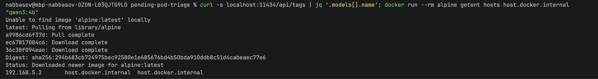

Кластер и две реплики api на разных воркерах:

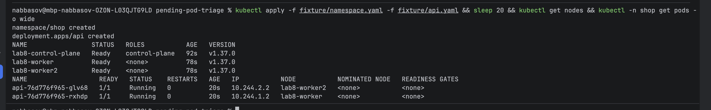

В kubeconfig для MCP адрес API-сервера записан как `https://lab8-control-plane:6443`: контейнер kubernetes MCP подключён к docker-сети `kind`, а `127.0.0.1:<порт>` из моего `~/.kube/config` внутри контейнера означал бы сам контейнер. Скрипт `scripts/make-mcp-kubeconfig.sh` создаёт ServiceAccount с ClusterRole только на чтение и выписывает токен на неделю.

Перед n8n проверил связность руками из контейнера n8n: healthz у filesystem MCP, список моделей Ollama и MCP-handshake (`initialize`) с kubernetes MCP:

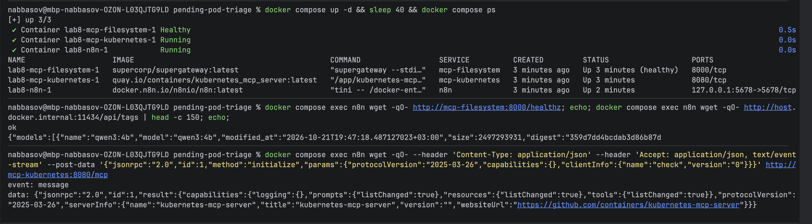

В n8n (`http://localhost:5678`) credential типа OpenAI с любым ключом и Base URL `http://host.docker.internal:11434/v1`, импорт `workflow.json`, выбрать credential в узле модели, Publish.

Ломаем api первым инцидентом: три реплики с required anti-affinity на двух воркерах. Планировщик честно пишет, что две ноды не прошли по anti-affinity, а на третьей taint:

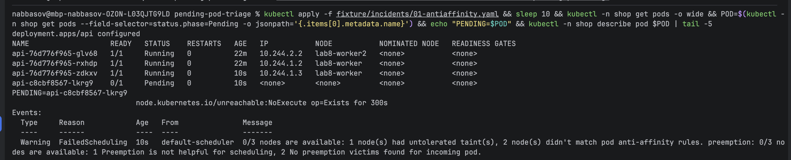

Дальше начались приключения.

### Запись файла

Первый же полный прогон: агент отработал, проверка прошла, упал узел Write report с `Access to the file is not allowed`. n8n по умолчанию не даёт файловым узлам писать куда попало, разрешённый каталог задаётся переменной `N8N_RESTRICT_FILE_ACCESS_TO`. Добавил в compose `/files`, пересоздал контейнер.

### Агент не вызывает инструменты

Файл записался, а внутри ерунда: категория `insufficient_resources`, сообщение планировщика «0/3 nodes are available: 1 node(s) not ready», в доказательствах имена инструментов вместо фактов. В кластере ничего похожего не было. Открыл execution: один вызов модели, ноль вызовов инструментов. В логах MCP-серверов за это время только `initialize` и `tools/list`, ни одного `tools/call`. То есть модель получила список инструментов и сочинила результат, не сходив никуда.

Проверил саму модель мимо n8n: запрос в Ollama с одним описанным инструментом. qwen3:4b вернула нормальный `tool_calls`. Значит проблема между n8n и Ollama.

Сначала грешил на узел Ollama Chat Model и заменил его на OpenAI Chat Model с Base URL на `/v1` Ollama. Не помогло, вызовов по-прежнему ноль. Потом заметил в узле переключатель Use Responses API, включённый по умолчанию. Через `/v1/chat/completions` Ollama инструменты отдаёт (проверил тем же curl), а через Responses API их теряет. Выключил, в логе Ollama запросы пошли на `/v1/chat/completions`, в промпте около двух тысяч токенов, то есть описания инструментов долетели.

И всё равно ноль вызовов. По логу Ollama видно: модель 40 секунд думает (2500 токенов рассуждений) и выдаёт сразу итоговый JSON. qwen3:4b видит в system message заполненный пример контракта и копирует его вместо того, чтобы сначала сходить за данными. Переписал skill (первое действие всегда `pods_get`, контракт без примера), взял qwen3:8b. Стало хуже: модель 22 секунды думает и заканчивает ход с пустым output, ни текста, ни вызова. У thinking-моделей через OpenAI-совместимый endpoint рассуждение уходит в отдельное поле, а действия после него не остаётся.

На этом месте остановился и признал: заставить локальную модель на 4–8 миллиардов параметров самостоятельно пройти цепочку из пяти вызовов инструментов и потом ещё правильно сравнить два YAML — ненадёжно. Это и есть главный вывод лабы про агентов: модель хорошо объясняет, но плохо собирает и сверяет.

### Переделка

Перенёс сбор данных в обычные узлы MCP Client: они вызывают `pods_get`, `events_list`, `read_text_file`, `resources_list` всегда, детерминированно, без участия модели. Сравнение манифеста с values тоже считает код. Модели остаётся интерпретация: что это значит, какое правило нарушено, что делать. Toolkit у агента при этом остался тот же, и он им иногда пользуется.

Модель заменил на qwen2.5:7b без режима размышлений. С ней проверка контракта ещё пару раз отбрасывала ответы: сначала `evidence` пришёл массивом объектов, потом `sources` вообще не массивом. Проверку сделал терпимее к форме (объекты склеиваются в строки), а `sources` отдал коду полностью. Параллельно добавил вывод категории из сообщения планировщика кодом: модель дважды ставила `insufficient_resources` на явный anti-affinity.

После этого прогоны стали стабильными.

### Результаты

Инцидент 1, anti-affinity. Execution целиком, 20 секунд, все узлы зелёные:

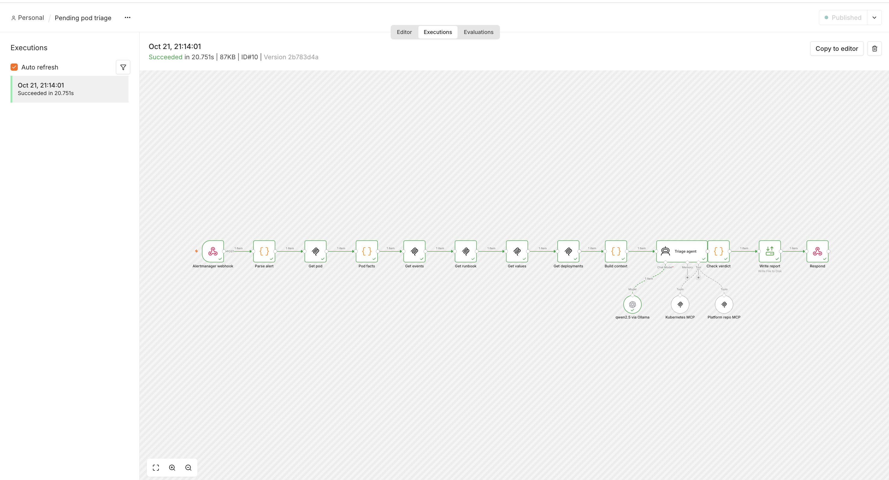

Ответ webhook и отчёт из `output/`:

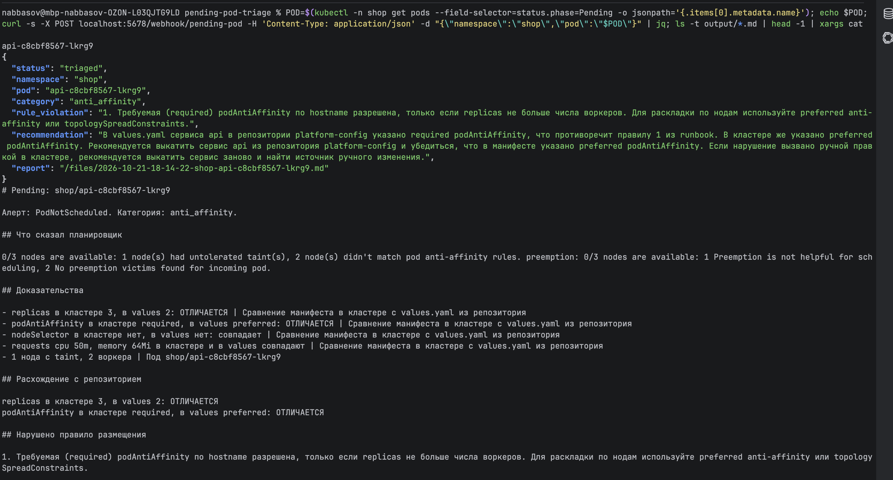

Дрейф найден ровно там, где он есть: в кластере 3 реплики и required, в values 2 и preferred. Нарушено правило 1 runbook, названо дословно. В рекомендации видно слабость модели: в первой фразе она перепутала, где required, а где preferred, но действие предлагает правильное — выкатить из репозитория и найти ручную правку.

Инцидент 2, запрос памяти 64Gi:

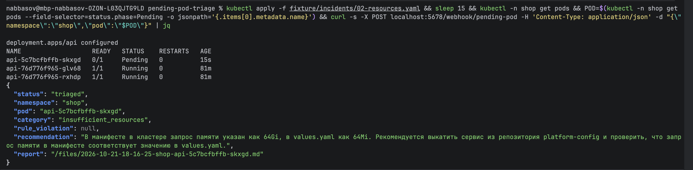

Инцидент 3, nodeSelector на лейбл, которого нет:

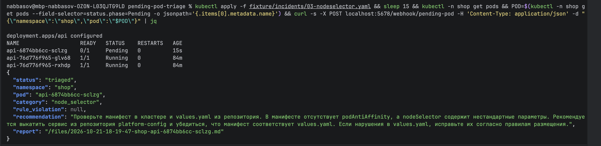

Категории и дрейф верные во всех трёх. На третьем модель не привязала правило 3 из runbook (nodeSelector только по разрешённым лейблам), хотя оно прямо про этот случай. Если бы делал дальше, проверку формальных правил runbook тоже перенёс бы в код по тому же принципу, что и категорию.

Вернуть рабочее состояние: `kubectl apply -f fixture/api.yaml`.

### colima

Посреди мониторинга упал docker-демон. Оказалось, активный профиль colima был не тот, что я думал: 2 CPU и 2 GiB, и в них жили kind на три ноды, n8n, два MCP, Prometheus, Grafana и blackbox. Перед падением API-сервер kind уже отвечал `TLS handshake timeout`. Поднял профиль заново с 6 GiB и 4 CPU, kind восстановился сам, compose-проекты запустил руками. Дыра в графике зависимостей с 21:27 до 21:32 — это оно.

## Part 4 — Мониторинг

Стек в `monitoring/`: Prometheus, Grafana, blackbox exporter. Отдельный compose-проект, подключается к сети основного.

Откуда метрики. У n8n есть свой `/metrics`, включается переменной `N8N_METRICS`, плюс флаги на лейблы workflow и счётчики. kubernetes-mcp-server сам отдаёт Prometheus-метрики на отдельном порту (`metrics_port` в его TOML), его Prometheus скрейпит напрямую. У filesystem MCP за supergateway и у Ollama метрик нет, для них стоит blackbox exporter: он ходит на `/healthz` supergateway и на `/api/tags` Ollama и отдаёт `probe_success`.

Дашборд `Pending pod triage` (provisioning из `monitoring/grafana/dashboards/`), четыре панели: запуски workflow по статусу, p50/p95 длительности успешного запуска, доступность трёх зависимостей, event loop lag и heap n8n.

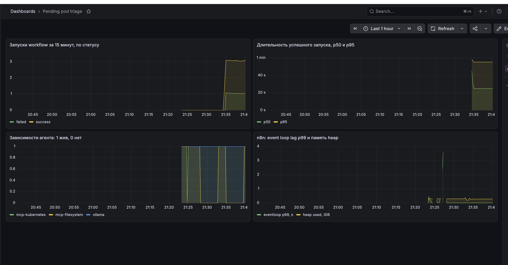

Запуски по статусу: три успешных и один с ошибкой, который я сделал специально кривым именем пода:

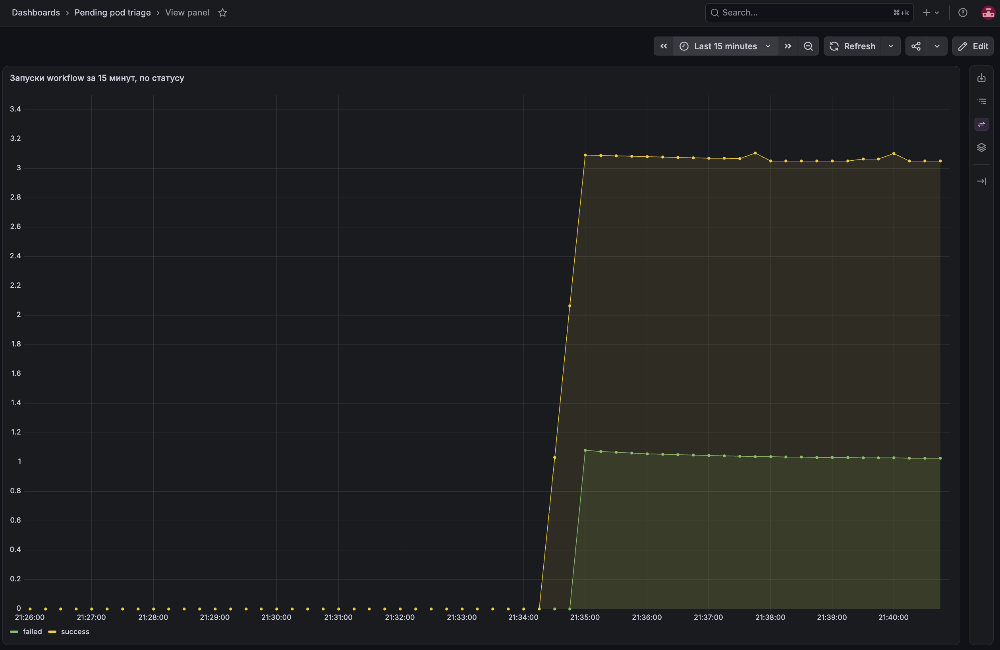

Зависимости: провалы mcp-filesystem — это я его останавливал, чтобы проверить алерт, а общая дыра посередине — падение colima:

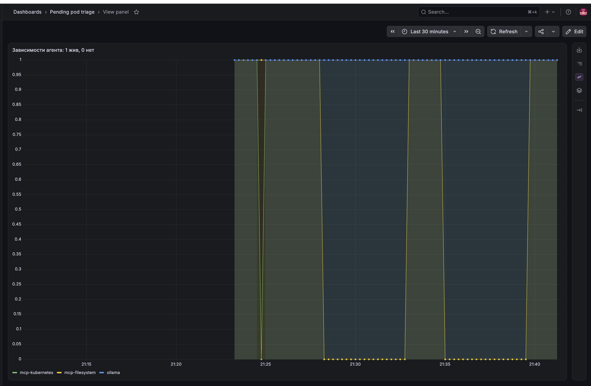

Алерты в `monitoring/alerts.yml`, три штуки:

1. `TriageWorkflowFailed` — `increase(n8n_workflow_execution_duration_seconds_count{status!="success"}[15m]) > 0`. Запусков мало, несколько в день, поэтому процент ошибок тут бессмыслен: одна ошибка уже значит, что конкретный разработчик не получил разбор и пошёл дёргать дежурного. Срабатывает с первого неуспешного запуска.
2. `TriageDependencyDown` — `up{job="mcp-kubernetes"} == 0 or probe_success{job="deps"} == 0`, с выдержкой 2 минуты. Без любого из трёх (kubernetes MCP, filesystem MCP, Ollama) агент не соберёт доказательства, и следующий алерт о Pending останется без ответа. Это нужно знать до того, как придёт следующий Pending, а не после. Две минуты отсекают рестарт контейнера.
3. `TriageTooSlow` — p95 длительности успешных запусков за 30 минут больше 180 секунд в течение 10 минут. Локальная модель и так небыстрая (сейчас p95 около минуты), но если p95 уходит за три минуты, это уже деградация: Ollama выгрузила модель и грузит заново, не хватает памяти, или агент крутится в лишних итерациях с tool-вызовами. Среднее такое спрячет, p95 покажет.

Первые два проверил вживую: кривой запрос и `docker compose stop mcp-filesystem`, через две с половиной минуты оба в firing:

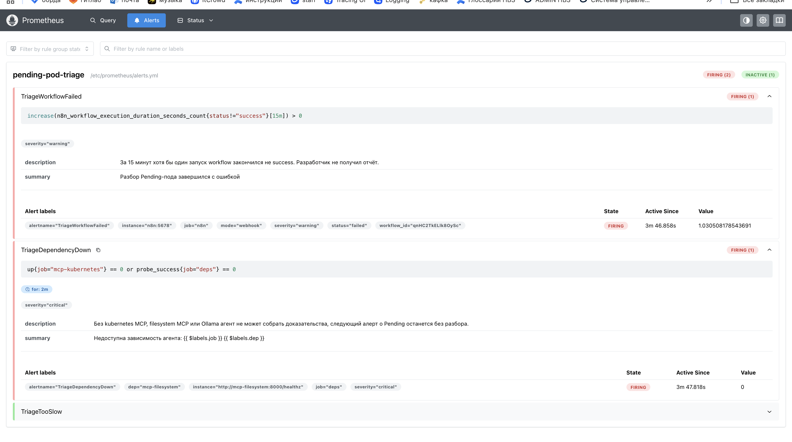

## Что сдаю

- `README.md` — этот файл;
- `workflow.json` — экспорт из n8n;
- `skills/pending-pod-triage.md` — skill агента;
- `screenshots/` — скрины запуска и мониторинга;
- `reports/` — три реальных отчёта агента по трём инцидентам, как есть, без правок;
- всё остальное в папке — чтобы можно было поднять у себя: `compose.yaml`, `monitoring/`, `fixture/`, `knowledge/`, `mcp/`, `scripts/`.
